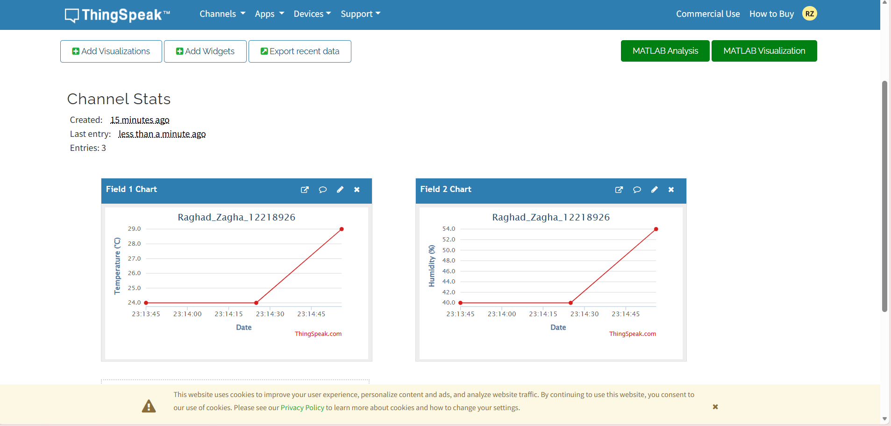
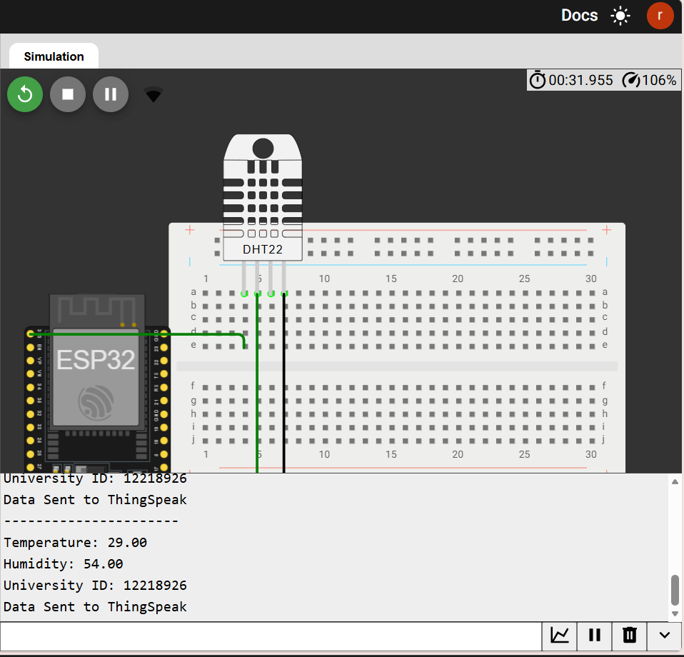
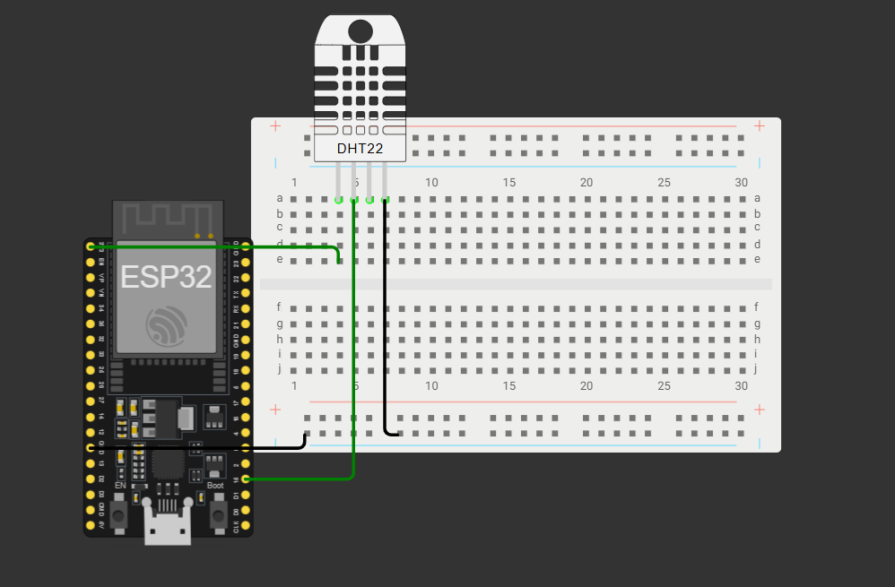
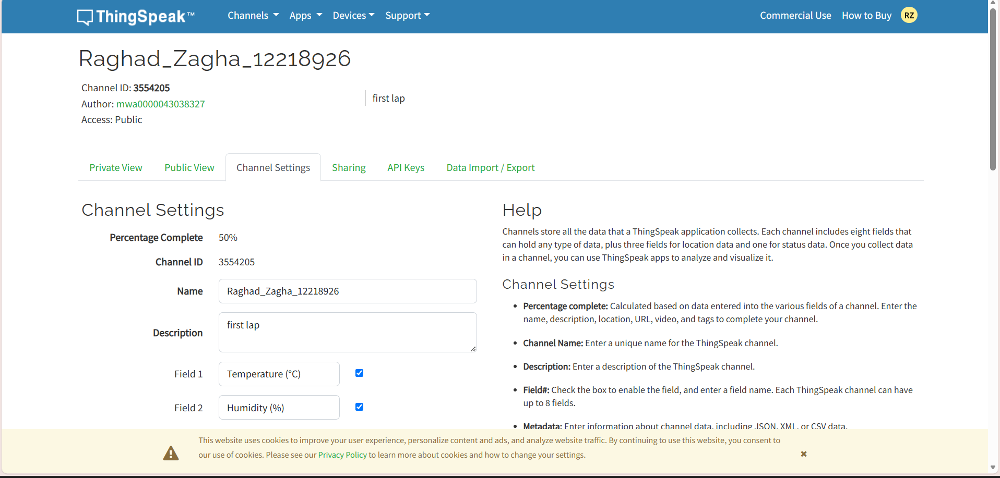

  Student Information

- Student Name: Raghad Zagha
- University ID: 12218926
- University: An-Najah National University

 
 
 ESP32 to ThingSpeak: Temperature and Humidity Monitoring

1. Project Description

This project is part of the ESP32 → ThingSpeak assignment.

The main objective is to use an ESP32 microcontroller and a DHT22 sensor to measure temperature and humidity, send the readings to ThingSpeak through Wi-Fi, and display the collected data using ThingSpeak charts.

The ESP32 reads the sensor data and uploads it to ThingSpeak every 20 seconds.

 2. Hardware and Simulation Setup

This project was implemented using the Wokwi online simulator.

 Components Used

- ESP32 DevKit Board
- DHT22 Temperature and Humidity Sensor

 Wiring Diagram

| DHT22 Pin | ESP32 Pin |
|---|---|
| VCC | 3.3V |
| GND | GND |
| DATA | GPIO 15 |

 3. ThingSpeak Channel Configuration

A ThingSpeak channel was created to receive and display the sensor readings.

 Channel Information

- Channel ID: 3554205
- Public View: Enabled

 Channel Fields

| Field | Name | Unit |
|---|---|---|
| Field 1 | Temperature | °C |
| Field 2 | Humidity | % |

The temperature and humidity readings are uploaded to their corresponding fields and displayed using ThingSpeak charts.

4. Wi-Fi Configuration

The ESP32 connects to the following Wi-Fi network in Wokwi:

- Wi-Fi Name: Wokwi-GUEST
- Password: Empty

 5. Program Description

The ESP32 program performs the following operations:

1. Initializes the DHT22 sensor.
2. Connects the ESP32 to the Wi-Fi network.
3. Initializes the ThingSpeak connection.
4. Reads temperature and humidity from the DHT22 sensor.
5. Displays the sensor readings in the Serial Monitor.
6. Sends temperature to ThingSpeak Field 1.
7. Sends humidity to ThingSpeak Field 2.
8. Uploads the readings every 20 seconds.
9. Displays the data transmission status in the Serial Monitor.

6. Software and Libraries

The project uses the following software and libraries:

- Wokwi ESP32 Simulator
- Arduino Framework
- ThingSpeak Library
- Adafruit DHT Sensor Library

 7. Project Links

- **ThingSpeak Public Channel:[YOUR_THINGSPEAK_PUBLIC_URL](https://thingspeak.mathworks.com/channels/3554205)
- **Wokwi Simulation:[YOUR_WOKWI_PROJECT_URL](https://wokwi.com/projects/479070917793970177)

8. Screenshots

### Wokwi Simulation and Wiring Diagram

 ThingSpeak Channel

 Temperature Chart

### Humidity Chart

 9. How to Run the Project

1. Open the Wokwi simulation using the project link.
2. Start the simulation.
3. Open the Serial Monitor.
4. Observe the temperature and humidity readings.
5. Open the ThingSpeak public channel.
6. Check the temperature and humidity charts.
7. Verify that the sensor data is being updated every 20 seconds.

 10. Conclusion

This project demonstrates the integration of an ESP32 microcontroller, a DHT22 sensor, Wi-Fi connectivity, and ThingSpeak for cloud-based temperature and humidity monitoring.

The sensor readings are sent to ThingSpeak and displayed using its built-in charts, fulfilling the main objectives of the assignment. 

